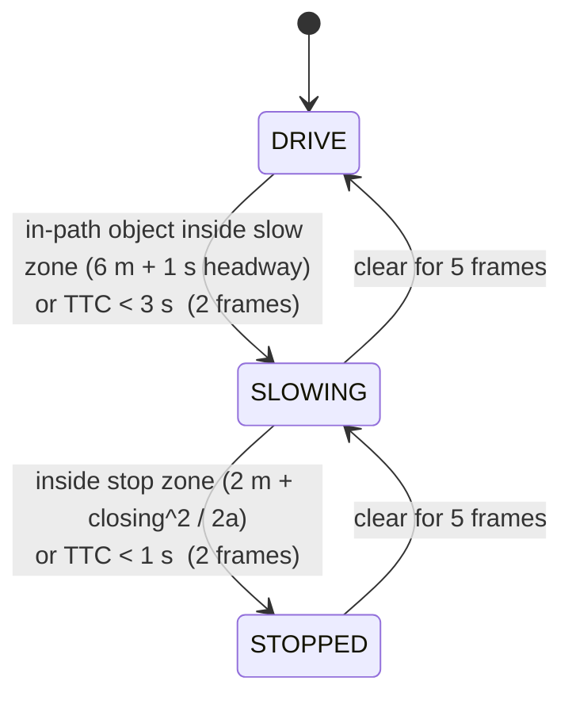
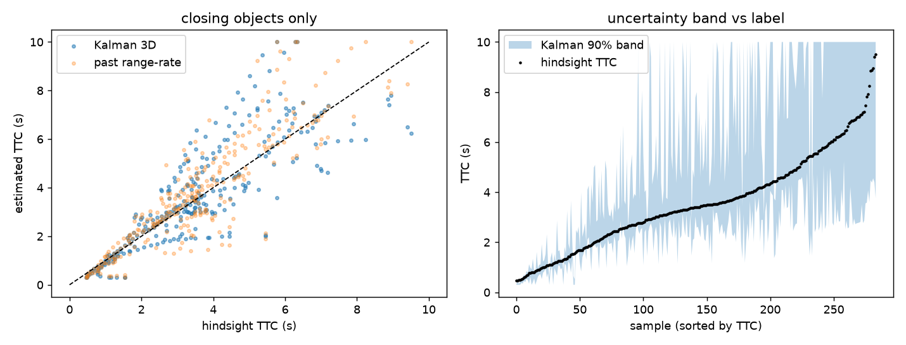
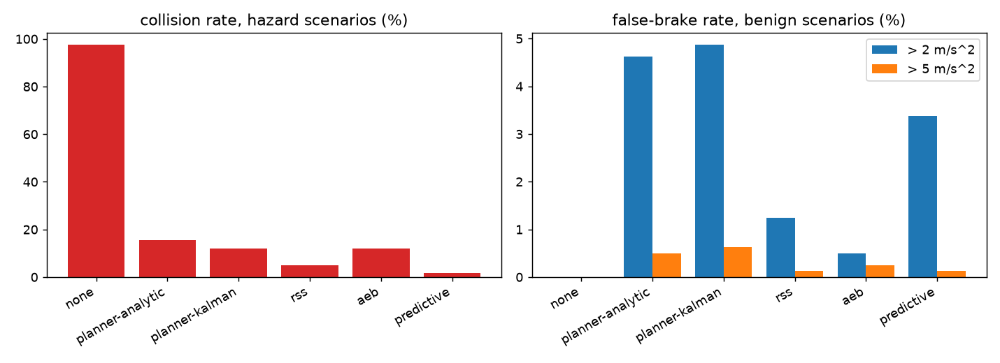
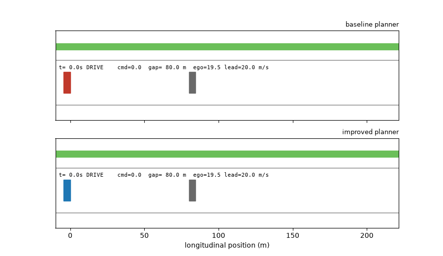

# Autonomous Perception & Safety Pipeline (KITTI)

An end-to-end perception stack for autonomous driving built on the KITTI raw dataset. It fuses a camera and a Velodyne LiDAR to track objects with real-world distances **and velocities** (3D Kalman tracks in a world frame), estimates the car's drivable path from lane markings and ego-motion, and runs a safety planner (DRIVE / SLOWING / STOPPED) driven by **time-to-collision (TTC)**, including a learned camera-only TTC network, Kalman TTC with calibrated uncertainty, and motion prediction. A closed-loop simulator measures what the planner actually prevents.

<p align="center">
  
</p>

| City drive (0005) | Open road (0013) |
|---|---|
|  |  |

[Download the demo frame as PDF](docs/demo_frame.pdf)

---

## Highlights

| | |
|---|---|
| **Sensor fusion** | LiDAR projected into the image; per-object range from the nearest LiDAR surface, with a local ground estimate so slopes are not mistaken for obstacles. Monocular range is the fallback. |
| **3D tracking** | LiDAR bird's-eye clusters -> constant-velocity Kalman filter in the **world frame** (ego-motion compensated), so a parked car has zero velocity however the ego car moves. Gives object velocity, closing speed and TTC with a **calibrated 90 % band**. |
| **Prediction** | Constant-velocity / constant-turn-rate prediction and an ego-path conflict check that sees an object *before* it enters the lane (opt-in `--predict`). |
| **Ego path** | Yaw-rate **curved corridor** plus a **metric bird's-eye lane** that is only trusted when it agrees with where the car is heading. |
| **Safety planner** | State machine with closing-speed stop zones, time-headway slow zones, TTC thresholds and hysteresis. |
| **Learned TTC** | Physics-informed GRU, camera + ego speed only; labels come from future LiDAR (hindsight). |
| **Closed-loop safety eval** | `safety_sim.py` replays the real tracker + planner on 8 generated scenario types and compares against RSS, a TTC-AEB and a predictive policy (collision rate, false-brake rate). |
| **Honest evaluation** | Every estimator is scored against ground truth derived from the vehicle's own OXTS trajectory; cross-validated TTC with baselines; negative results are reported. |
| **Engineering** | Per-stage latency profiling (`--profile`), 120 unit tests, an agentic safety-falsification framework (`autonomy_redteam/`), Dockerfile, GitHub Actions CI, one-command KITTI download. |

## Architecture


Per frame the pipeline matches the camera image to the nearest LiDAR scan and OXTS packet by timestamp, then runs two perception branches (lane + ego motion, and object tracking), fuses them with the LiDAR, estimates TTC, and lets the planner decide.



---

## Technical details

### 1. Time sync and calibration
- Synced drives (`*_sync`) have one LiDAR `.bin` per frame. Unsynced drives (`*_extract`) have `.txt` scans and 100 Hz OXTS; each camera frame is matched to the nearest LiDAR scan (within 60 ms) and nearest OXTS packet.
- Calibration is read from `calib_*.txt` in `data/` (`scripts/download_kitti.py` fetches the official files); without them the built-in rounded 2011_09_26 defaults are used.

### 2. LiDAR fusion
1. Remove ego-vehicle points and ground: a **local per-cell ground estimate** (1 m cells, 3x3 minimum) keeps only points more than 0.5 m above the local ground, so hills and embankments do not become phantom obstacles.
2. Project the remaining points into the image (`Tr_velo_to_cam`, `R_rect`, `P_rect`).
3. A tracked box's range is the median of the **nearest LiDAR surface** inside its central region. If too few points exist it falls back to monocular range from box height (`L` / `M` tag in the video label).
4. An object is **in path** if its *ground footprint* falls inside the ego-path mask (plus a lateral limit for near points) and the points form a cluster, so stray returns cannot trigger braking.

### 3. 3D tracking and Kalman TTC (`tracker3d.py`)
1. Obstacle points are rasterised into a 0.4 m bird's-eye grid; 8-connected components become object proposals (walls/hedges longer than 12 m are dropped).
2. Cluster centres are moved into a **world frame** with the OXTS pose and tracked with a constant-velocity Kalman filter `[x, y, vx, vy]` (Hungarian association, gated; a track is confirmed after 3 hits, so one-frame ghosts never reach the planner).
3. Per track: ego-relative position/velocity, bumper range, closing speed, and `TTC = range / closing` with a **90 % band** from the filter covariance. The raw covariance under-covers (41 % actual coverage), so sigma is scaled by 3.2, fitted on training drives and checked leave-one-drive-out (89 % coverage).
4. Tracks are matched to YOLO boxes by projecting the track centre into the image; the video label shows each object's ground speed.
5. `--ttc kalman` makes the planner use this TTC per object (the LiDAR range-rate safety layer still applies).

### 4. Motion prediction (`predict.py`)
Static / constant-velocity / constant-turn-rate models in the world frame, and `time_to_conflict`: roll the ego car forward on its current-curvature arc and return the first time the footprints overlap. With `--predict`, objects that are *not yet* in the corridor but are predicted to conflict within 3 s enter the planner as **advisory** obstacles: they can cause SLOWING, never STOPPED.

### 5. Ego path: curved corridor + gated metric lane
- **Curved corridor.** Curvature `k = yaw_rate / speed` (OXTS, causal, clipped to +/-0.05 1/m) bends a vehicle-width corridor ahead of the car.
- **Metric bird's-eye lane.** Lane markings (HLS white/yellow + top-hat) are warped to a bird's-eye view using a ground-plane homography built from the calibration, so the fit `y = c2*x^2 + c1*x + c0` is in **metres**. That allows physical checks: width 2.4-4.6 m, ego inside the lane, near-centred, left/right parallel.
- **Path gate.** Markings fire on crosswalks, curbs and intersection paint. A lane is only accepted if its centre is within 1 m of the yaw-rate path near the car.
- The planner path is `curved corridor U accepted lane`, so a bad lane can never hide an obstacle straight ahead (this is a deliberate safety choice; it costs path precision, see results).
- Single-line inference (extending one visible line by a fixed lane width) is **off** by default. It was measured harmful on the first two drives; on the current seven it raises lane-only IoU (0.31 -> 0.37) and I have not yet re-evaluated it at path level, so it stays off.

### 6. Object tracking
YOLOv8 detection with BoT-SORT keeps persistent IDs for cars, trucks, buses, motorbikes, bikes and people. Per-track range is EMA-smoothed; a range jump no real object could produce between consecutive measurements resets the filter instead of producing a bogus TTC.

### 7. Safety planner
| Element | Rule |
|---|---|
| Stop zone | `2 m + c^2 / (2 * 8 m/s^2)`, with `c` the **closing** speed (a lead car at your speed is not a wall) |
| Slow zone | `6 m + 1 s * ego speed` (time headway) |
| TTC | < 3 s slow, < 1 s stop |
| Hysteresis | 2 frames to escalate, 5 to release (immediate for extreme cases) |
| Safety layer | in-path LiDAR range-rate TTC always applies, even when the network or Kalman TTC is in charge |

### 8. Learned TTC
- **Inputs** (last 8 frames of one track, camera + ego speed only): log box height/width, box centre, bottom edge, class group, monocular range, ego speed, growth rates of box size, elapsed time.
- **Model:** physics-informed. For an object of constant size `TTC = 1 / (d log(box height) / dt)`. The network starts from that estimate (least-squares slope over the window), and a GRU adds a bounded correction (`|delta log TTC| <= 1.5`, zero-initialised output layer), so it starts exactly at the physics baseline and can only move away where the data supports it. A plain GRU without this prior was no better than "always predict 10 s".
- **Labels:** hindsight TTC = range / closing speed from a linear fit of LiDAR range over the *next* 5 frames, clipped to [0.3, 10] s. KITTI has no collisions, so this is *kinematic* TTC.
- **Planner modes:** `--ttc analytic | learned | fused | kalman` (`fused` = geometric mean of analytic and learned).

---

## Results

Seven KITTI drives from 2011_09_26 (city and open road, 1,150 frames; official calibration). Reproduce with the commands in *Quick start*. All numbers below come from the committed code; `docs/tracking3d_eval.json` and `docs/safety_sim.json` hold machine-readable versions of the last two sections.

### Ego path vs the vehicle's actual trajectory
Ground truth is the **driven path** from OXTS poses (no manual labels), widened to 2.2 m and compared on the ground plane 7-30 m ahead. All drives pooled (`python src/eval_lane.py`).

| Estimator | Available | Recall | Precision | IoU | Lane centre error |
|---|---|---|---|---|---|
| straight corridor (old default) | 100% | 0.77 | 0.63 | 0.53 | - |
| **curved corridor (yaw rate)** | 100% | 0.83 | **0.76** | **0.65** | - |
| lane, legacy image-space | 47% | 0.23 | 0.36 | 0.17 | 1.15 m |
| lane, metric BEV (2 lines) | 62% | 0.48 | 0.48 | 0.31 | 0.57 m |
| lane, metric BEV + single-line inference | 78% | 0.61 | 0.48 | 0.37 | 0.56 m |
| lane, metric BEV, **gated** | 45% | 0.44 | 0.59 | 0.34 | **0.37 m** |
| path: legacy lane U straight corridor (original) | 100% | 0.80 | 0.51 | 0.45 | - |
| path: metric lane U curved corridor, ungated | 100% | **0.90** | 0.58 | 0.54 | - |
| **path: gated lane U curved corridor (current)** | 100% | 0.88 | 0.65 | 0.60 | - |


- The metric lane is a clear improvement over the legacy detector (IoU 0.17 -> 0.31 ungated, 0.34 gated, centre error 1.15 m -> 0.37 m). The gate removes false lanes and keeps accuracy: gated precision 0.59 vs 0.48.
- The curved corridor alone has the best IoU (0.65). Taking its **union** with the lane raises recall (0.83 -> 0.88) but costs precision (0.76 -> 0.65): the union is a deliberate safety choice (a bad lane can never hide an obstacle), not an accuracy optimisation. A path built for accuracy would weight the corridor more.
- These numbers differ from the first version of this README (two drives, rounded calibration, gated lane on 8 % of frames). With seven drives and the official calibration the lane detector works on far more frames; earlier conclusions about its unreliability applied to those two drives.

### Distance: monocular vs LiDAR (LiDAR = reference)
| Drive | Boxes with LiDAR support | Median relative error | MAE |
|---|---|---|---|
| 0001 (city) | 92% | 8% | 2.8 m |
| 0002 (city) | 88% | 20% | 3.1 m |
| 0005 (city) | 99% | 16% | 3.3 m |
| 0011 (city) | 90% | 8% | 3.2 m |
| 0013 (open road, unsynced) | 30% | 26% | 3.3 m |
| 0014 (city) | 93% | 8% | 4.1 m |
| 0017 (city) | 100% | 6% | 1.4 m |
| **pooled (3,087 boxes)** | | **10%** | **3.4 m** |

By range (pooled): 0-10 m median error 28 % (MAE 2.9 m), 10-20 m 10 % (2.8 m), >20 m 7 % (4.1 m). Monocular range is worst up close, where a few pixels of box height matter most.


### 3D tracker: Kalman TTC and motion prediction
`python src/eval_tracking3d.py` (LiDAR + OXTS only). In-path, confirmed tracks; hindsight TTC label as below (714 samples, 110 with TTC < 3 s).

| Method | log-MAE | MAE where TTC<6 s | Precision | Recall | F1 | False pos. |
|---|---|---|---|---|---|---|
| Kalman 3D (causal) | 0.16 | 0.78 s | 0.73 | **0.89** | **0.80** | 37 |
| range-rate, past 5 frames | **0.13** | **0.70 s** | 0.72 | 0.85 | 0.78 | 37 |
| static-world: range / ego speed | 0.54 | 1.69 s | 0.39 | 0.87 | 0.54 | 151 |
| constant 10 s | 0.48 | 6.92 s | - | 0.00 | 0.00 | 0 |



- Kalman TTC is **not more accurate** than a plain range-rate fit: slightly higher recall and F1, slightly worse log-MAE; labels and both estimators come from the same LiDAR, so differences this small are within noise. What it adds is the object's own velocity (a parked car is recognised as static) and **uncertainty**.
- The raw filter covariance under-covers badly: its nominal 90 % band contains the hindsight TTC for 41 % of closing samples. After scaling sigma by 3.2, **leave-one-drive-out coverage is 89 %** (per drive 80-100 %), at a median band width of 2.5x (hi/lo).

Motion prediction error vs the filtered position, moving tracks only (25 tracks of >= 25 frames, so treat as indicative):

| Model | ADE @ 1 s | @ 2 s | @ 3 s |
|---|---|---|---|
| static | 9.5 m | 18.7 m | 29.8 m |
| constant velocity | 1.28 m | 2.69 m | 4.22 m |
| constant turn rate | **1.18 m** | **2.53 m** | 4.22 m |

The ground truth here is the tracker's own smoothed position (KITTI raw has no object labels), so this measures prediction consistency, not absolute accuracy.

### Closed-loop safety simulation
`python src/safety_sim.py --n 200` runs 1,600 episodes per policy. The real tracker and planner see noisy LiDAR cluster measurements (0.1 m + 0.2 % of range noise, 10 % dropout, range limits 55 m cars / 35 m pedestrians, one-frame ghost clusters); braking acts through a 0.2 s actuator lag, max 8 m/s². Hazard scenarios: lead car braking (3-8 m/s²), parked car in lane, cut-in, pedestrian crossing. Benign scenarios (braking = false alarm): car following at 2-3 s headway, adjacent-lane pass, sidewalk pedestrian, oncoming traffic.

| Policy | Collisions (hazards) | Mean impact speed | False-brake rate (> 2 m/s²) | Hard false brakes (> 5 m/s²) |
|---|---|---|---|---|
| no braking | 97.6 % | 11.9 m/s | 0 % | 0 % |
| planner, analytic TTC (the pipeline's default) | 15.6 % | 5.3 m/s | 4.6 % | 0.5 % |
| planner, Kalman TTC | 12.1 % | 5.4 m/s | 4.9 % | 0.6 % |
| RSS longitudinal rule | 5.0 % | 6.9 m/s | 1.2 % | 0.1 % |
| TTC-based AEB (2.5 s / 1.2 s) | 12.0 % | 6.3 m/s | 0.5 % | 0.2 % |
| **predictive (CV conflict within 4 s)** | **1.6 %** | 7.8 m/s | 3.4 % | 0.1 % |

Collisions per hazard scenario (%): planner-analytic 24 lead-brake / 0 parked / 4 cut-in / 34 pedestrian; planner-Kalman 18 / 0 / 4 / 26; RSS 0 / 0 / 6 / 14; predictive 2 / 0 / 4 / 0.



What this shows, and what it does not:
- The production planner reacts to the *current* in-path state, so it is late for pedestrians that step into the lane (34 % collisions) and weaker than RSS overall. Kalman TTC helps modestly (24 -> 18 % and 34 -> 26 %); predicting the conflict removes almost all pedestrian collisions.
- Scenarios and sensor noise are my own and the sim has no clutter or occlusion. Policy thresholds were fixed before running; the only change after a first trial run was the `follow` scenario (its original 20-30 m gap was an arguable braking case, so it now uses a normal 2-3 s headway). The relative ranking is the result; absolute rates are not predictions for real roads. Its false-brake numbers are optimistic for the predictive policy: on real KITTI drives `--predict` adds extra SLOWING (see next section) that cannot be judged without ground truth.
- Statistical resolution: 200 episodes per scenario, so single-scenario rates carry roughly +/- 3 points.

### Learned TTC
Out-of-fold, blocked time cross-validation (4 folds, all drives pooled, purged so no input/label window overlaps a test window). "Positive" = hindsight TTC < 3 s. 1,369 samples, 412 positives.

| Method | log-MAE | MAE where TTC<6 s | Precision | Recall | F1 | False pos. |
|---|---|---|---|---|---|---|
| **learned** (camera + ego) | 0.229 | 1.20 s | 0.82 | 0.75 | 0.78 | 69 |
| tau prior alone (camera) | 0.228 | 1.42 s | 0.81 | 0.69 | 0.74 | 69 |
| analytic range-rate, LiDAR (past 5 frames) | 0.241 | 1.30 s | 0.83 | 0.79 | 0.81 | 69 |
| analytic range-rate, monocular | 0.265 | 1.49 s | 0.77 | 0.78 | 0.78 | 94 |
| constant 10 s | 0.650 | 7.25 s | - | 0.00 | 0.00 | 0 |


A camera-only network lands within a few F1 points of the LiDAR range-rate baseline, and slightly improves log-MAE and error on closing objects, but **does not beat LiDAR range-rate on F1** (0.78 vs 0.81). In leave-one-drive-out testing it is also behind (F1 0.77 vs 0.81). Two of the seven drives (0013, 0017) contain no TTC < 3 s events, so per-drive numbers there are meaningless.

### Planner modes on the real drives
`python src/main.py --ttc <mode>` then `python src/compare_modes.py`. Frames per state over all seven drives (1,150 frames, no frame is ever STOPPED):

| Mode | DRIVE | SLOWING | Frames that differ from analytic |
|---|---|---|---|
| analytic | 988 | 162 | - |
| kalman | 988 | 162 | 0 |
| fused (learned, in-sample) | 980 | 170 | 8 |
| `--predict` (advisory) | 864 | 286 | 124 |

- KITTI contains no near-collisions, so TTC almost never decides the outcome: Kalman TTC changes **zero** frames, fused changes 8 (in-sample: the network was trained on these drives). The closed-loop simulator above exists because logged data cannot measure collision avoidance.
- `--predict` adds 124 SLOWING frames (mostly the city drives, e.g. ego turning through an intersection past crossing cyclists and pedestrians). It is opt-in because there is no ground truth for whether those slow-downs were needed. A first version that also allowed STOPPED fired 50 STOP frames in drive 0005 where nothing needed one, which is why predicted conflicts are advisory-only.


### Latency
`python src/main.py --profile` on this laptop's CPU (no GPU), per frame, median over seven drives: lane detection 12-14 ms, YOLOv8s + BoT-SORT 37-39 ms, LiDAR ground removal + clustering + 3D tracking 8-14 ms, fusion 0.1-0.6 ms, planner < 0.1 ms. Total about **66-76 ms per frame (13-15 fps, p95 12-14 fps)** including image decode and LiDAR parsing, so it keeps up with KITTI's 10 Hz LiDAR; YOLO dominates. The unsynced drive (0013) reads LiDAR from text files and takes 177 ms for the 3D stage, which is parsing, not computation. Clustering costs 3.6 ms and the Kalman update 0.7 ms per frame.

---

## Autonomy Red Team: agentic safety falsification

`autonomy_redteam/` is a testing framework wrapped around the closed-loop simulator and the real planner (`src/safety_sim.py`, `src/behavior_manager.py`, `src/tracker3d.py`). It searches for scenarios where the stack fails, shrinks each failure to a small reproducible case, tests which component caused it, and turns the case into a regression test. The search, metrics and diagnosis are deterministic and run on CPU in seconds, with no KITTI data, GPU, CARLA or API key. An LLM can be added for the investigation step. It never decides pass or fail.

```bash
python -m autonomy_redteam fix-demo --out docs/redteam/failure_to_fix   # the complete failure-to-fix cycle below (~15 s)
python -m autonomy_redteam demo                                    # search -> investigate -> minimise -> diagnose -> promote -> regress (~5 s)
python -m autonomy_redteam search --budget 100 --seed 42           # [--method random|cmaes]
python -m autonomy_redteam minimize --scenario path/to/failure.json
python -m autonomy_redteam diagnose --scenario path/to/failure.json          # contributed / outcome-improving / root-cause verdict
python -m autonomy_redteam compare --split heldout --planners baseline improved   # before/after planner comparison (docs/redteam/planner_eval)
python -m autonomy_redteam regress --suite scenarios/regression/ --baseline scenarios/baselines/v1.json            # legacy single-seed
python -m autonomy_redteam regress --suite scenarios/regression/ --baseline scenarios/baselines/v2_improved.json --planner improved   # contracts + statistics
python -m autonomy_redteam baseline --suite scenarios/regression/ --out my_baseline.json --version x --seeds 12    # >= 2 seeds: format-2 baseline
python -m autonomy_redteam evaluate [--planner baseline|improved]  # the framework's own evaluation (~6 min on one core)
python -m autonomy_redteam diag-eval --split dev|heldout|calibrate  # diagnosis attribution before/after on planted faults
python -m autonomy_redteam regression-eval --split dev|heldout      # regression detector FP/FN on planner mutations
python -m autonomy_redteam agent --scenario path/to/failure.json   # optional; deterministic investigator unless an LLM is configured
```
Other subcommands: `investigate`, `promote`, `suite`. Every simulator command takes `--planner {baseline,improved}` (the braking planner; `kalman`/`analytic` are accepted as aliases of `--ttc-mode`), `--ttc-mode {kalman,analytic}` and `--override KEY=VALUE`, which patches `src/config.py` thresholds to emulate a new software version. `python -m autonomy_redteam <cmd> --help` lists the options. `src/safety_sim.py --policy planner-improved` runs the improved planner in the original simulator. Reports and plots from the first investigation are in [`docs/redteam/example_report.md`](docs/redteam/example_report.md); the current ones are under [`docs/redteam/failure_to_fix/`](docs/redteam/failure_to_fix/).

### Case study: found, diagnosed, fixed, validated, protected
Everything below is produced by `fix-demo` (report: [`docs/redteam/failure_to_fix/report.md`](docs/redteam/failure_to_fix/report.md)). The numbers are from executed simulations.



1. **Failure.** A 100-simulation random search finds 28 failing scenarios. The most severe, shrunk by minimisation to *no injected fault at all*, is a lead at 20 m/s, 80 m ahead, braking gently at 2 m/s² while the ego does 19.5 m/s. The original planner collides in 16/16 noise seeds at about 6.6 m/s impact speed.
2. **Mechanism** (read from the telemetry, then confirmed by controlled experiments). The planner leaves DRIVE at t = 8.5 s but SLOWING commands only 2.4 m/s² (0.3 × max) while the physics needs about 5.3 m/s² on average (peak 9.9). STOPPED is reached with 10.5 m left at 13 m/s closing; full 8 m/s² braking needs 14.5 m once actuator lag is counted, plus the 2 m it wants to keep. The stop zone assumes instantaneous braking, and the escalation confirmation and range-filter lag use up the remaining margin. Neither a perception fault nor the RSS-style reference rule is involved: the reference avoids it in 8/8 seeds on the same perception.
3. **Fix** (`src/safe_braking.py`, `--planner improved`, deterministic, no LLM): required deceleration `a_req = c²/(2·(gap - 2 - c·τ))` from closing speed and separation, with τ the actuator lag plus control step plus filter delay; proportional braking with a 1.25 margin capped at the physical limit; TTC may not trigger a STOP on its own; an unconfirmed track cannot trigger hard braking; a hysteresis band on release. The original planner stays selectable (`--planner baseline`) and is bit-identical to before (checked on 590 episodes against the committed code).
4. **Validation.** On the minimised scenario: 16/16 collisions -> 0/16 (mean minimum gap 0.0 -> 7.7 m). On 300 fresh random scenarios that were not used for design: collisions 26.0 % -> 8.3 %, margin violations (< 1 m) 30.7 % -> 9.7 %, unnecessary braking 6.7 % -> 3.3 % (not significant, p = 0.08); paired exact McNemar p < 1e-12 for collisions.
5. **Protection.** The failure is now `scenarios/regression/known_failure_gentle_lead_braking.json`. Recorded on the improved planner (`scenarios/baselines/v2_improved.json`) it is a *contract*: no collision in any of 12 paired seeds. The original planner run against that baseline fails the gate with a hard safety violation (`tests/test_contracts.py` asserts it).

**Planner: before / after on held-out data** ([`docs/redteam/planner_eval/`](docs/redteam/planner_eval/planner_comparison_heldout.md)). The improved policy was frozen and fingerprinted before the held-out sets were generated (`docs/redteam/heldout_freeze.json`). Held-out sets use unseen seeds, and one has an ego-speed range (16-20 m/s) that no development set contained. Same scenarios, noise seeds, simulator and metric definitions for every planner; paired exact McNemar and bootstrap CIs.

| Held-out set (n) | Avoidable collisions, baseline -> improved | Margin violation (< 1 m) | Unnecessary braking |
|---|---|---|---|
| random (500) | 31.6 % -> 7.8 % (-23.8 pp, CI [-27.6, -20.2]) | 37.0 % -> 9.0 % | 6.0 % -> 4.2 % (p = 0.2) |
| ego speed 16-20 m/s (300) | 46.0 % -> 12.7 % (-33.3 pp, CI [-39.3, -27.3]) | 50.7 % -> 15.7 % | 10.7 % -> 1.7 % |
| near the RSS boundary, fault-free (150) | 17.3 % -> 0.0 % | 26.0 % -> 1.3 % | 0.0 % -> 0.0 % |

Controls and honest trade-offs, from the same files:
- Simply lowering the stop-zone's assumed braking (`EMERGENCY_DECEL=4`, a threshold-only change) also cuts collisions (31.6 % -> 15.4 % on the random set) but at 2-3x the unnecessary braking of the baseline (17.0 % vs 6.0 %), and an RSS reference rule brakes unnecessarily in 32 % of random scenarios. The improved planner is better on both axes.
- The remaining improved-planner collisions are mostly perception-fault cases (lead lost or very late), not planner logic; the originally discovered fault-laden scenario still collides under the improved planner (16/16), and the diagnosis now says why (below).
- Planner state transitions per minute rise on the random set (13.8 -> 17.5), and the mean impact speed *given* a collision is not lower (7.3 -> 8.3 m/s: what remains are the harder cases).
- Post-hoc sensitivity (not pre-registered): with a slower 0.3 s actuator the improved planner remains much better than the baseline (`planner_sensitivity.json`).
- The improvement is measured in my simulator with a first-order actuator and my sensor model. It says nothing about a real vehicle.

**Diagnosis: before / after** ([`docs/redteam/diagnosis_eval/`](docs/redteam/diagnosis_eval/)). The old Shapley view measured which *repair* changes the failure rate, not which component failed first, so in a scenario the planner only narrowly fails, fixing almost anything "helps". `attribution.py` keeps three questions apart: *contributed* (the component was observably wrong before the point of no return **and** ground-truth replacement changes the outcome), *an intervention improves the outcome*, and *primary root cause* (a contributor with a large effect and no comparable rival), with explicit **joint** and **inconclusive** verdicts. Observed-error detectors read telemetry only (lost-track runs, fitted lag, range residual and raw-return jitter, TTC log-ratio) and never the scenario's fault parameters (a test enforces this). Thresholds come from fault-free runs only (`nominal_calibration.json`).

| | dev set (seed 11; 49 planted, 20 no-fault) | held-out (seed 9011; 50 planted, 30 no-fault) |
|---|---|---|
| old: top-1 Shapley accuracy | 75.5 % (latency 3/12) | 94.0 % (latency 10/12) |
| old: no-fault control, a perception component falsely *supported* | 6/20 (30 %) | 11/30 (37 %) |
| old: planted component labelled *supported* | 95.9 % | 92.0 % |
| new: planted component is the unique primary cause | **42/49 (85.7 %)**, 95 % CI 73-93 % | **46/50 (92.0 %)**, CI 81-97 % |
| new: correct but reported jointly / inconclusive / wrong | 1 / 6 / 0 | 1 / 3 / 0 |
| new: any other component flagged on a planted case | 1/49 | 1/50 |
| new: no-fault control, a perception component flagged | 1/20 (5 %) | 1/30 (3 %) |
| new: no-fault control, planner logic named the unique cause / inconclusive | 14/20 / 5/20 | 19/30 / 10/30 |

The reproduced old numbers (top-1 75.5 %, latency 25 %, null false perception 30 %, planted-supported 96 %) are exact on the dev set. The held-out draw shows the old method is much better there (94 %, latency 10/12), so the earlier latency weakness was partly specific to the dev draw; the stable difference is the no-fault false-support rate and the lack of any *inconclusive* outcome. Several dev iterations (a point-of-no-return deadline instead of first-insufficient-command, an unwarranted-braking window, a raw-return jitter detector, thresholds at 1.5 x the nominal p99) were made after looking at dev results; the held-out set was run once after freezing. The new engine trades coverage for precision: 12 % (dev) and 6 % (held-out) of planted cases are inconclusive, mostly mild range noise whose effect is invisible in the filtered telemetry. TTC-error planted cases could be built only twice per split, so that row is not evidence. All three flagged-extra cases (one no-fault control and one extra component on a planted case per split) involve the TTC estimator: its natural error during hard-braking approaches (median |log ratio| 0.68-0.78) exceeds the 0.59 bound calibrated on nominal runs (nominal maximum 0.70), and replacing it with the true TTC does remove every failure in those episodes. I count them as false positives because no TTC fault was injected, but they may be a genuine natural-estimator contribution.

**Regression detection: before / after** ([`docs/redteam/regression_eval/`](docs/redteam/regression_eval/)). The original detector compared one noise seed per scenario against fixed tolerances. The new one (`contracts.py`, baseline format 2) runs 12 paired seeds per scenario and separates **hard safety violations** (a scenario-level contract derived from the baseline: robustly safe scenarios must stay collision-free; promoted known failures must not get materially worse), **statistically meaningful degradation** (exact tests with a controlled false-alarm budget: Bonferroni-corrected Fisher per scenario, pooled McNemar and sign tests over all scenario/seed pairs), **informational** changes and **within-tolerance** differences. Only the first two fail CI. Ground truth for "harmful" is measured on a separate label set (600 random scenarios, paired exact McNemar p < 0.01) and not from the mutation's intent.

| | old detector | new detector (suite) | new detector (suite + 6 safe contracts) |
|---|---|---|---|
| dev: 18 pre-registered mutations + identity, harmful detected | 4/4 | 4/4 | 4/4 |
| dev: non-harmful flagged | **8/15** | 4/15 | 4/15 |
| held-out: 24 new mutations + identity, harmful detected | 7/7 | 6/7 (missed `SLOW_HEADWAY=0.4`) | 7/7 |
| held-out: non-harmful flagged | **6/17** | 2/17 | 3/17 |
| noise-only: unchanged planner, baseline and current recorded on different seeds, flagged in 40 trials (dev / held-out) | 40/40 / 40/40 (an approximate re-implementation of the single-seed checks) | 0/40 / 0/40 | 1/40 / 0/40 |

The old dev numbers reproduce exactly. The new detector's design (single-seed bootstrap tests were too noisy and flagged 83 % of noise-only trials; they were replaced by Bonferroni-corrected exact tests and pooled sign tests, and 8 seeds became 12) was iterated on the dev results, so the dev column is not held-out evidence; the held-out column is, and it was run once with the detector hash recorded beforehand (`heldout_freeze.json`). Remaining false positives are mixed-effect changes (some scenarios worse, some better, net neutral on the label set, e.g. `EMERGENCY_DECEL=14`) that the suite, which is deliberately near the failure boundary, picks up. Improvements are no longer flagged unless they break a contract.

### Design
| Module | Role |
|---|---|
| `scenario.py` | Parameterised, validated, JSON-round-trippable scenarios (ego/lead speed, gap, lead braking, plus six fault groups: latency, distance noise, dropout, detection-loss window, TTC error, ghost clusters). The seed gives bit-exact replay. A generator keeps starts outside an already-unavoidable hazard. |
| `sut.py`, `adapters/` | Generic `SystemUnderTest` interface (reset/step, ground-truth, perception and planner telemetry, events, interventions). `SafetySimSUT` steps the real planner in a loop that mirrors `run_episode`, with fault hooks and oracle interventions. A parity test checks it against the production planner. CARLA/ROS 2 adapters are *not* implemented; only the interface is shaped for them. |
| `metrics.py`, `oracle.py` | Deterministic assessment from ground truth only: collision, near miss, missed hazard, unnecessary braking, min gap and TTC, impact speed, brake reaction time. Kinematic oracles (max-brake from t=0, an RSS reference with perfect information) separate **unavoidable / hard / avoidable** collisions. Unavoidable collisions are not reported as planner bugs. |
| `search.py` | Seeded random search and a small custom CMA-ES, with a hard simulation budget and a cache. |
| `minimize.py` | Delta debugging over fault groups, then bisection of each fault severity and each physical parameter toward a benign value. Judged on a multi-seed predicate and checked for deterministic replay and for failure on a fresh SUT. The result is *a* boundary point, not a unique minimum. |
| `diagnose.py`, `interventions.py` | Counterfactual replay: fix each of four perception components (detection, distance, TTC, latency) alone and in combination, with the same noise seeds. Wilson 90% intervals plus a Shapley attribution of failure probability. A separate planner-logic test uses ideal perception and the RSS reference. Labels are *supported / weak / not supported*, with the rule stated in the report. |
| `findings.py`, `report.py`, `investigate.py` | Equivalence signature (kind, necessary faults, lead regime), ranked findings, and a nine-section Markdown report with telemetry plot, counterfactual plot and GIF. |
| `regress.py`, `suite.py` | Legacy format-1 baseline JSON: one seed per scenario, fixed tolerances (gap 0.5 m, impact 1.0 m/s, TTC 0.3 s, reaction 0.2 s), statuses *unchanged / improved / fixed / worsened / new_failure*. Exit code 1 on violation. Kept for compatibility (`scenarios/baselines/v1.json`). |
| `contracts.py` | Format-2 baselines: paired noise seeds, scenario roles (*safe_contract*, *known_failure*, *marginal*), hard safety violations vs statistically meaningful degradation (exact Fisher / McNemar / sign tests) vs informational vs within-tolerance. Deterministic: baseline and current run use the same seeds. |
| `attribution.py` | Separates *contributed*, *intervention improves the outcome* and *primary root cause* from telemetry-observed errors, a point-of-no-return deadline and controlled replacement; explicit *joint* and *inconclusive* verdicts. Never reads the injected-fault labels. |
| `planner_eval.py`, `diagnosis_eval.py`, `regression_eval.py` | The before/after evaluations (dev vs held-out splits, frozen before the held-out run, CIs and paired tests). |
| `fix_demo.py` | One command for the whole discovery -> minimise -> diagnose -> fix -> validate -> protect cycle. |
| `src/safe_braking.py` | The improved braking policy (`SafeBehaviorManager`), selectable next to the unchanged original (`make_behavior_manager`). |
| `agent/` | Optional LLM investigator (see below). |

### Optional LLM investigation agent
`python -m autonomy_redteam agent` (or `LLMInvestigator`) lets a model choose among **seven tools**: `get_scenario`, `get_telemetry_window`, `minimize_scenario`, `run_full_diagnosis`, `run_counterfactual`, `run_scenario_variant`, `finish`. Hard limits apply to tool calls, simulation runs, tokens and wall time, and a scenario variant must stay inside the scenario bounds. Every metric the model sees comes from the deterministic code, and a hypothesis must cite run ids that exist. Suggested scenarios are replayed by the framework and the outcome is recorded, not taken from the model. The agent never touches planner code and never decides collision status. Configure it through environment variables only: `OPENAI_API_KEY` or `REDTEAM_LLM_API_KEY` (OpenAI-compatible, optional `REDTEAM_LLM_BASE_URL`) or `ANTHROPIC_API_KEY`, optional `REDTEAM_LLM_PROVIDER`, and a required `REDTEAM_LLM_MODEL`. Nothing is hardcoded, and the model name has no default. Without a key the same tool interface is driven by `DeterministicInvestigator`.

### Evaluation of the framework itself
Full output: [`docs/redteam/evaluation_summary.md`](docs/redteam/evaluation_summary.md) and the JSON next to it. Settings: budget 150 per trial, 10 trials, same seeds for all methods, one CPU core, 365 s in total. These are properties of this simulator and planner, and nothing here is evidence about real vehicles.

| Question | Result |
|---|---|
| Random vs CMA-ES, unique *reproducible* findings per 150-sim trial | Full parameter box: random 14.6 ± 2.9, CMA-ES 12.8 ± 4.3 (difference -1.8, 95% bootstrap CI [-4.0, 0.2], so **no measurable advantage**). Rare-failure box (smaller hazard region): random 8.8 ± 0.9, CMA-ES 13.3 ± 3.6 (+4.5, CI [2.0, 6.8]). CMA-ES makes many more *failing* evaluations (131 vs 51 of 150) but mostly near-duplicates of the same finding. |
| Minimisation (40 distinct failures) | 100% still fail on a fresh SUT, 100% replay deterministically. Active perturbations 3.5 -> 1.85. **Caveat:** the failure rate over 20 fresh noise seeds falls from 0.76 (original) to 0.51 (minimised), and seed-fragile cases (< 25%) go from 5% to 22%. Minimised cases sit nearer the failure boundary, so they are less robust to noise. |
| Diagnosis, original Shapley engine (49 planted-fault cases, dev) | Planted component labelled *supported* in 96 %. Top-1 Shapley accuracy 75 % overall (detection loss 100 %, distance noise 100 %, dropout 92 %, **latency 25 %**); precision of *supported* labels 81 %. On 20 failing scenarios with no injected fault a perception component was **falsely** labelled *supported* in 30 %. On a fresh held-out draw the same engine scores 94 % top-1 (latency 10/12) and 37 % false support, so the latency weakness was partly sample-specific. |
| Diagnosis, new attribution engine | See the before/after table in the case study: unique correct 86 % (dev) and 92 % (held-out), 0 wrong, 12 % / 6 % explicitly inconclusive, and a perception component flagged in 1/20 and 1/30 no-fault controls. |
| Regression detection | See the before/after table in the case study: non-harmful changes flagged 8/15 -> 4/15 (dev) and 6/17 -> 2/17 (held-out) with no loss of harmful detections on the extended suite, and about 0 % false alarms under pure seed noise. The mutation list and label set of the *original* evaluation were fixed before it was run; the new detector was tuned on those dev results and judged on a separate held-out set. |
| Agent-guided search vs deterministic | **Not run.** There is no API key in this environment and the agent is not a search driver. No claim is made that it finds more failures. |

### Limits of the red-team framework
- It covers one scenario family: **longitudinal car-following with a single lead vehicle**. There are no lane changes, pedestrians or lateral motion.
- The simulator has a simple kinematic model, no clutter or occlusion, and a latency model quantised to 0.1 s. TTC-error injection and TTC oracles only apply in `kalman` mode.
- "Unnecessary braking" is judged against a constant-speed lead at the onset of hard braking, so braking that anticipates a lead's *future* braking counts as unnecessary.
- Counterfactual interventions are defined by me (what "ideal detection" means); components interact, so attribution is evidence and not proof.
- The signature used to group findings can merge distinct mechanisms or split one. Of the committed regression failures, four have different parameters but all are lead-braking collisions.
- The LLM HTTP clients are tested only against a scripted fake, never a live API. The agent path is untested end to end with a real model.
- Baselines `scenarios/baselines/*.json` were generated on macOS with Python 3.12. GitHub Actions (Ubuntu, Python 3.11 and 3.12) ran every workflow step on the `redteam-failure-to-fix` branch and all passed, as did the same steps in a Linux Docker container (aarch64), so there is no platform-specific baseline drift on those three. Only scenarios with at least 1.5 m of baseline margin carry hard contracts, and everything near the boundary goes through the statistical tier.
- The improved planner, the attribution engine and the format-2 detector were all developed against this simulator's failure modes. Each is judged on held-out data that I did not look at during development, but the held-out sets come from the same generator and simulator; they test overfitting to a scenario, not generalisation to another simulator.
- Held-out samples are modest (50 planted cases, 24 mutations): the confidence intervals above are wide and a single case moves a percentage by 2 points. The `ttc_error` fault could be constructed only twice per split, so its diagnosis accuracy is unmeasured.
- Contracts are strict by design: a change that fixes many failures but breaks one robustly safe scenario is still reported as a hard violation (annotated with the net effect), which the benchmark labels count as a false positive when the net effect is an improvement.
- Not implemented: CARLA and ROS 2 adapters, a hosted service or UI.

---

## Quick start
```bash
pip install -r requirements.txt
python scripts/download_kitti.py           # more city drives + official calibration into data/ (optional)
python src/main.py --gif --profile         # every drive under data/ -> output/<drive>/
python src/evaluate.py                     # distance + planner metrics, docs/*.png
python src/eval_lane.py                    # score ego-path / lane estimators vs the driven path
python src/eval_tracking3d.py              # Kalman TTC (+ calibrated band) and motion prediction
python src/safety_sim.py --n 200           # closed-loop collision / false-brake evaluation
python src/train_ttc.py                    # cross-validate + train models/ttc_gru.pt
python src/main.py --ttc kalman            # planner uses the 3D Kalman TTC (also: learned, fused)
python src/main.py --predict               # + advisory slow-down for predicted ego-path conflicts
python src/compare_modes.py output_a output_b   # planner states between runs (--output-dir)
python src/make_figures.py                 # architecture diagram + demo-frame PDF
python -m pytest -q tests                  # 160 unit tests (about 15 s)
python -m autonomy_redteam demo            # safety falsification demo: no data, GPU or API key (see below)
python -m autonomy_redteam fix-demo        # failure -> diagnosis -> fix -> validation -> regression contract (~15 s)
scripts/ci_local.sh                        # every step of the CI workflow, locally
```
`python src/main.py --help` lists options (`--drive PATH` (repeatable), `--max-frames`, `--no-video`, `--ttc {analytic,learned,fused,kalman}`, `--predict`, `--profile`, ...).

Docker (tests by default; mount KITTI data to run the pipeline):
```bash
docker build -t lanedet .
docker run --rm -v $PWD/data:/app/data -v $PWD/output:/app/output lanedet python src/main.py --profile
```

Outputs per drive in `output/<drive>/`: `frames/`, `adu_perception_final.mp4`, `demo.gif`, `telemetry.csv`, `tracks.csv` (also the TTC training data), `tracks3d.csv` (3D Kalman tracks with velocity, TTC and band), `latency.csv`, `summary.txt`.

Expected data layout: KITTI raw drives under `data/` (each with `image_02/data`, `velodyne_points/data`, `oxts/data`, timestamps).

## Repository layout
| File | Role |
|---|---|
| `src/main.py` | pipeline orchestration / CLI (all drives) |
| `src/config.py` | paths and every tunable threshold |
| `src/datasets.py` | `Drive`: synced/unsynced KITTI access, timestamp matching, ego pose/velocity, driven-path ground truth |
| `src/calibration.py` | KITTI calibration (parses `calib_*.txt`, else built-in defaults) |
| `src/lane_utils.py` | metric bird's-eye view, lane fit in metres, `LaneTracker`, path-consistency gate, drawing |
| `src/lane_legacy.py` | original image-space lane detector, kept as an evaluation baseline |
| `src/eval_lane.py` | ego-path ground truth from OXTS and scores for every path/lane estimator |
| `src/obstacle_utils.py` | YOLO track extraction, monocular distance, drawing |
| `src/fusion_utils.py` | LiDAR projection, local ground removal, per-box range, ego-path masks, in-path tests |
| `src/tracker3d.py` | LiDAR clustering, world-frame Kalman tracker, TTC with calibrated band, box matching |
| `src/predict.py` | CV / CTRV prediction, ego-path conflict time, displacement errors |
| `src/eval_tracking3d.py` | Kalman TTC vs hindsight labels, band calibration (leave-one-drive-out), prediction ADE |
| `src/safety_sim.py` | closed-loop scenarios, sensor model, policies (planner, planner-improved, RSS, AEB, predictive) |
| `src/safe_braking.py` | improved deterministic braking policy (`SafeBehaviorManager`); the original `BehaviorManager` is unchanged and remains the default |
| `src/behavior_manager.py` | planner FSM (closing-speed zones, TTC modes, advisory conflicts, hysteresis) |
| `src/ttc_model.py`, `src/ttc_data.py`, `src/train_ttc.py` | learned TTC: model, hindsight-label dataset, cross-validation and training |
| `src/evaluate.py`, `src/compare_modes.py` | distance / planner metrics, timelines, planner-mode comparison |
| `src/make_figures.py` | architecture diagram and demo-frame PDF |
| `scripts/download_kitti.py` | fetch extra KITTI drives + calibration (keeps only the data the pipeline reads) |
| `autonomy_redteam/` | scenario search, failure minimisation, counterfactual diagnosis, regression suites and optional LLM investigator around `safety_sim.py` (see the Autonomy Red Team section) |
| `scenarios/regression/`, `scenarios/baselines/` | committed regression scenarios (12: the earlier failures, near-boundary passes, the fixed failure, four robustly safe contracts) and the versioned baselines: legacy `v1.json`, format-2 `v2_original.json` and `v2_improved.json` |
| `docs/redteam/` | example report, the failure-to-fix case study (`failure_to_fix/`), planner / diagnosis / regression evaluations (`planner_eval/`, `diagnosis_eval/`, `regression_eval/`), freeze records and the framework evaluation results |
| `tests/` | 160 unit tests (planner, fusion, ground filter, lane geometry, TTC model/labels, tracker, prediction, simulator; `test_redteam.py`, `test_safe_braking.py`, `test_attribution.py`, `test_contracts.py`, `test_cli_outputs.py` for the red-team framework, the improved planner and the CLI) |
| `Dockerfile`, `.github/workflows/ci.yml`, `scripts/ci_local.sh` | container, CI (pytest, simulator smoke test, legacy + format-2 regression, failure-to-fix and demo smoke tests) and a local runner of the same steps |

## Known limitations
- **Still a small dataset.** Seven drives (1,150 frames). Only 25 moving-object tracks are long enough to score prediction, two drives contain no TTC < 3 s event, and drive 0013 (unsynced, text LiDAR) gets LiDAR support on only 30 % of boxes. All results are on KITTI raw city/road drives from one recording day; nothing here is evidence of generalisation to other sensors, cities or weather.
- **No standard benchmark yet.** I have not run the KITTI tracking/detection benchmarks (HOTA/MOTA, 3D AP) or any Waymo/nuScenes data: KITTI raw has no object labels, so tracking quality is only indirectly measured (TTC against hindsight, prediction consistency). The 3D detector is LiDAR clustering, not a learned detector (OpenPCDet-style models need a CUDA GPU).
- Hindsight TTC labels use LiDAR range-rate over 0.5 s; they measure kinematic TTC, not real collision risk, and share noise with the LiDAR-based baselines and the Kalman tracker.
- The safety simulator uses my own scenarios, noise model and fixed thresholds, with no clutter or occlusion; compare policies, not absolute rates. `--predict` has no ground truth on real data.
- Lane markings are accepted by the gate on 45 % of frames; elsewhere the yaw-rate corridor lags at the start of a turn and cannot anticipate one. A road-segmentation network would be the real fix but is not included.
- The ground-plane homography assumes flat ground at the nominal camera height; on slopes lane geometry in metres is slightly off.
- Far objects (>25 m) often have too few LiDAR points above the 0.5 m threshold and fall back to monocular distance.
- On unsynced drives each frame is paired with the nearest LiDAR scan (up to 60 ms away); at 12 m/s that is up to ~0.7 m of range error.
- **Docker and GitHub Actions status.** The Docker image was built and run on Linux (aarch64, Python 3.12): all 160 tests pass in the container, and so do the simulator smoke test, both regression gates, the failure-to-fix demo and the demo smoke test. Building it exposed a real bug (two test files read committed artifacts under `docs/`, which `.dockerignore` excluded), now fixed. 

## Possible next steps
Run on Waymo Open Dataset Perception v2.0.1 (Parquet, per-component download) for labelled 3D boxes and tracking IDs, and evaluate tracking with HOTA; swap LiDAR clustering for a learned 3D detector; train a lane/drivable-area segmentation network; add a ROS 2 wrapper.

## Tech stack
Python 3, OpenCV, NumPy, SciPy, PyTorch, Ultralytics (YOLOv8 + BoT-SORT), Matplotlib, Pillow. Data: KITTI Vision Benchmark Suite (raw city / road drives).
