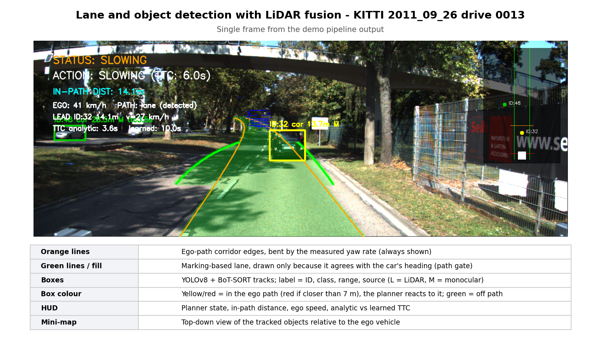
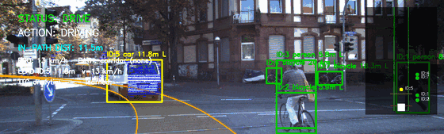
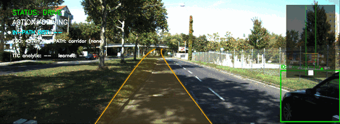
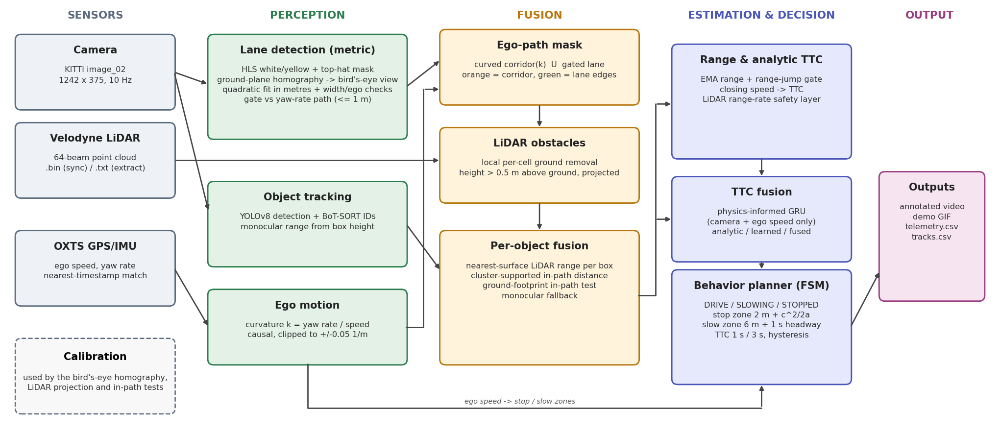
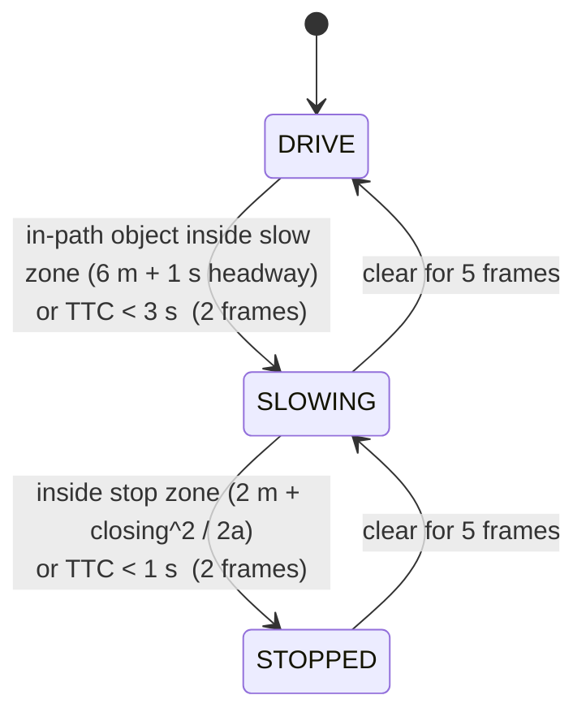
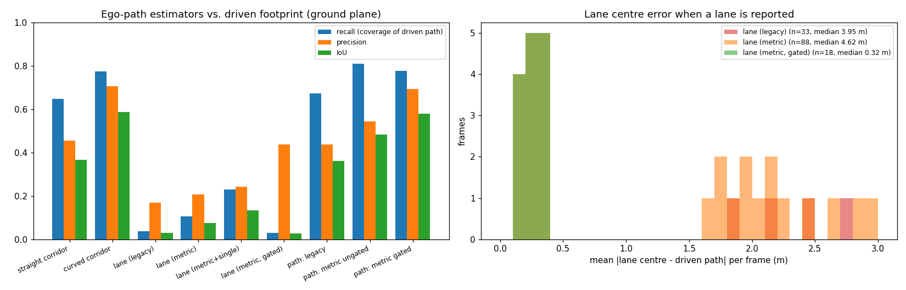
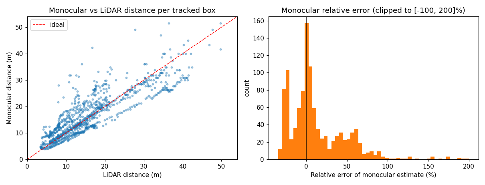
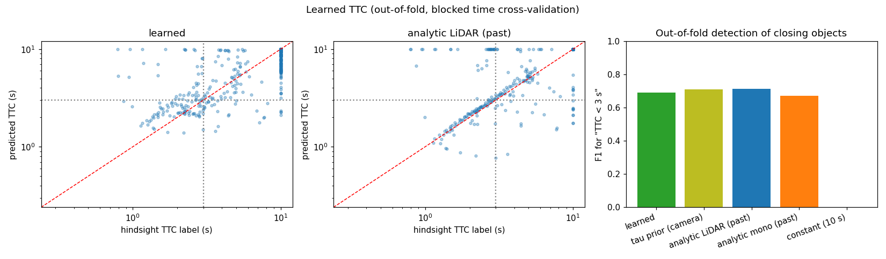
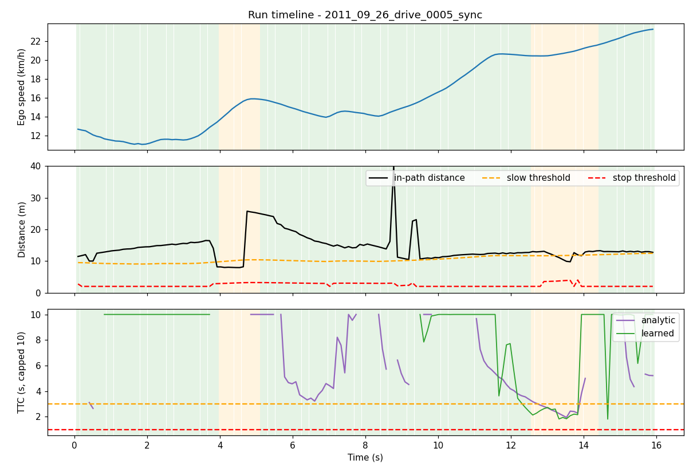

# Autonomous Perception & Safety Pipeline (KITTI)

An end-to-end perception stack for autonomous driving built on the KITTI raw dataset. It fuses a camera and a Velodyne LiDAR to track objects with real-world distances, estimates the car's drivable path from lane markings and ego-motion, and runs a safety planner (DRIVE / SLOWING / STOPPED) driven by **time-to-collision (TTC)**, including a **learned, camera-only TTC network**.

<p align="center">
  
</p>

| City drive (0005) | Open road (0013) |
|---|---|
|  |  |

[Download the demo frame as PDF](docs/demo_frame.pdf)

---

## Highlights

| | |
|---|---|
| **Sensor fusion** | LiDAR projected into the image; per-object range from the nearest LiDAR surface, with a local ground estimate so slopes are not mistaken for obstacles. Monocular range is the fallback. |
| **Ego path** | Yaw-rate **curved corridor** plus a **metric bird's-eye lane** that is only trusted when it agrees with where the car is heading. |
| **Tracking** | YOLOv8 + BoT-SORT with persistent IDs. |
| **Safety planner** | State machine with closing-speed stop zones, time-headway slow zones, TTC thresholds and hysteresis. |
| **Learned TTC** | Physics-informed GRU, camera + ego speed only; labels come from future LiDAR (hindsight). |
| **Honest evaluation** | Every estimator is scored against ground truth derived from the vehicle's own OXTS trajectory; cross-validated TTC with baselines. |

## Architecture



Per frame the pipeline matches the camera image to the nearest LiDAR scan and OXTS packet by timestamp, then runs two perception branches (lane + ego motion, and object tracking), fuses them with the LiDAR, estimates TTC, and lets the planner decide.



---

## Technical details

### 1. Time sync and calibration
- Synced drives (`*_sync`) have one LiDAR `.bin` per frame. Unsynced drives (`*_extract`) have `.txt` scans and 100 Hz OXTS; each camera frame is matched to the nearest LiDAR scan (within 60 ms) and nearest OXTS packet.
- Calibration is read from `calib_*.txt` in `data/` if present, otherwise built-in 2011_09_26 defaults are used.

### 2. LiDAR fusion
1. Remove ego-vehicle points and ground: a **local per-cell ground estimate** (1 m cells, 3x3 minimum) keeps only points more than 0.5 m above the local ground, so hills and embankments do not become phantom obstacles.
2. Project the remaining points into the image (`Tr_velo_to_cam`, `R_rect`, `P_rect`).
3. A tracked box's range is the median of the **nearest LiDAR surface** inside its central region. If too few points exist it falls back to monocular range from box height (`L` / `M` tag in the video label).
4. An object is **in path** if its *ground footprint* falls inside the ego-path mask (plus a lateral limit for near points) and the points form a cluster, so stray returns cannot trigger braking.

### 3. Ego path: curved corridor + gated metric lane
- **Curved corridor.** Curvature `k = yaw_rate / speed` (OXTS, causal, clipped to +/-0.05 1/m) bends a vehicle-width corridor ahead of the car.
- **Metric bird's-eye lane.** Lane markings (HLS white/yellow + top-hat) are warped to a bird's-eye view using a ground-plane homography built from the calibration, so the fit `y = c2*x^2 + c1*x + c0` is in **metres**. That allows physical checks: width 2.4-4.6 m, ego inside the lane, near-centred, left/right parallel.
- **Path gate.** Markings fire on crosswalks, curbs and intersection paint. A lane is only accepted if its centre is within 1 m of the yaw-rate path near the car.
- The planner path is `curved corridor U accepted lane`, so a bad lane can never hide an obstacle straight ahead.
- Single-line inference (extending one visible line by a fixed lane width) is **off** - it measurably hurts (see results).

### 4. Object tracking
YOLOv8 detection with BoT-SORT keeps persistent IDs for cars, trucks, buses, motorbikes, bikes and people. Per-track range is EMA-smoothed; a range jump no real object could produce between consecutive measurements resets the filter instead of producing a bogus TTC.

### 5. Safety planner
| Element | Rule |
|---|---|
| Stop zone | `2 m + c^2 / (2 * 8 m/s^2)`, with `c` the **closing** speed (a lead car at your speed is not a wall) |
| Slow zone | `6 m + 1 s * ego speed` (time headway) |
| TTC | < 3 s slow, < 1 s stop |
| Hysteresis | 2 frames to escalate, 5 to release (immediate for extreme cases) |
| Safety layer | in-path LiDAR range-rate TTC always applies, even when the network is in charge |

### 6. Learned TTC
- **Inputs** (last 8 frames of one track, camera + ego speed only): log box height/width, box centre, bottom edge, class group, monocular range, ego speed, growth rates of box size, elapsed time.
- **Model:** physics-informed. For an object of constant size `TTC = 1 / (d log(box height) / dt)`. The network starts from that estimate (least-squares slope over the window), and a GRU adds a bounded correction (`|delta log TTC| <= 1.5`, zero-initialised output layer), so it starts exactly at the physics baseline and can only move away where the data supports it. A plain GRU without this prior was no better than "always predict 10 s".
- **Labels:** hindsight TTC = range / closing speed from a linear fit of LiDAR range over the *next* 5 frames, clipped to [0.3, 10] s. KITTI has no collisions, so this is *kinematic* TTC.
- **Planner modes:** `--ttc analytic | learned | fused` (geometric mean).

---

## Results

### Ego path vs the vehicle's actual trajectory
Ground truth is the **driven path** from OXTS poses (no manual labels), widened to 2.2 m and compared on the ground plane 7-30 m ahead. Both drives pooled (`python src/eval_lane.py`).

| Estimator | Available | Recall | Precision | IoU | Lane centre error |
|---|---|---|---|---|---|
| straight corridor (old default) | 100% | 0.65 | 0.46 | 0.37 | - |
| **curved corridor (yaw rate)** | 100% | **0.78** | **0.71** | **0.59** | - |
| lane, legacy image-space | 14% | 0.04 | 0.17 | 0.03 | 3.95 m |
| lane, metric BEV (2 lines) | 37% | 0.11 | 0.21 | 0.07 | 4.62 m |
| lane, metric BEV + single-line inference | 85% | 0.23 | 0.24 | 0.13 | 1.91 m |
| lane, metric BEV, **gated** | 8% | 0.03 | 0.44 | 0.03 | **0.32 m** |
| path: legacy lane U straight corridor (original) | 100% | 0.67 | 0.44 | 0.36 | - |
| path: metric lane U curved corridor, ungated | 100% | 0.81 | 0.54 | 0.48 | - |
| **path: gated lane U curved corridor (current)** | 100% | 0.78 | 0.69 | 0.58 | - |



- The biggest gain is the **yaw-rate corridor**, not a better lane detector: on the city drive recall goes from 0.18 to 0.55 because the car turns through an intersection.
- Marking-based lanes are **unreliable on this data** when ungated (crosswalks and intersection paint in 0005, road-edge lines in 0013). When a lane passes the gate it is accurate (0.32 m) but that is only 8% of frames, so it does not measurably change the planner path (IoU 0.58 vs 0.59). It is shown in the video as a trustworthy extra.

### Distance: monocular vs LiDAR (LiDAR = reference)
| Drive | Boxes with LiDAR support | Median relative error | MAE |
|---|---|---|---|
| 0005 (city) | 98% | 16% | 3.3 m |
| 0013 (open road) | 32% | 26% | 3.2 m |



### Learned TTC
Out-of-fold, blocked time cross-validation (4 folds, all drives pooled, purged so no input/label window overlaps a test window). "Positive" = hindsight TTC < 3 s.

| Method | log-MAE | MAE where TTC<6 s | Precision | Recall | F1 | False pos. |
|---|---|---|---|---|---|---|
| **learned** (camera + ego) | 0.26 | 1.65 s | 0.74 | 0.65 | 0.69 | 25 |
| tau prior alone (camera) | 0.21 | 1.90 s | 0.82 | 0.63 | 0.71 | 16 |
| analytic range-rate, LiDAR (past 5 frames) | 0.19 | 1.75 s | 0.77 | 0.66 | 0.71 | 22 |
| analytic range-rate, monocular | 0.25 | 2.12 s | 0.69 | 0.65 | 0.67 | 33 |
| constant 10 s | 0.47 | 6.98 s | - | 0.00 | 0.00 | 0 |



A camera-only estimate matches the LiDAR range-rate baseline (F1 about 0.70 for the tau prior, the learned model and LiDAR). The learned correction slightly lowers error on closing objects but is **not better overall**, and the differences are within what about 500 correlated samples can resolve.

### Planner (analytic vs `--ttc fused`)
| Drive | Analytic (frames) | Fused (frames) | Frames that differ | State changes (without hysteresis) |
|---|---|---|---|---|
| 0005 (city) | 128 DRIVE / 26 SLOW / 0 STOP | 125 / 29 / 0 | 3 | 4 (6) |
| 0013 (open road) | 83 / 67 / 0 | 83 / 67 / 0 | 0 | 4 (5) |

The fused model was trained on these same drives, so this comparison is in-sample.



---

## Quick start
```bash
pip install -r requirements.txt
python src/main.py --gif                   # every drive under data/ -> output/<drive>/
python src/evaluate.py                     # distance + planner metrics, docs/*.png
python src/eval_lane.py                    # score ego-path / lane estimators vs the driven path
python src/train_ttc.py                    # cross-validate + train models/ttc_gru.pt
python src/main.py --ttc fused             # re-run with the learned TTC in the planner
python src/make_figures.py                 # architecture diagram + demo-frame PDF
python -m unittest discover -s tests -v    # unit tests (40)
```
`python src/main.py --help` lists options (`--drive PATH` (repeatable), `--max-frames`, `--no-video`, `--ttc {analytic,learned,fused}`, ...).

Outputs per drive in `output/<drive>/`: `frames/`, `adu_perception_final.mp4`, `demo.gif`, `telemetry.csv`, `tracks.csv` (also the TTC training data), `summary.txt`.

Expected data layout: KITTI raw drives under `data/` (each with `image_02/data`, `velodyne_points/data`, `oxts/data`, timestamps).

## Repository layout
| File | Role |
|---|---|
| `src/main.py` | pipeline orchestration / CLI (all drives) |
| `src/config.py` | paths and every tunable threshold |
| `src/datasets.py` | `Drive`: synced/unsynced KITTI access, timestamp matching, driven-path ground truth |
| `src/calibration.py` | KITTI calibration (parses `calib_*.txt`, else built-in defaults) |
| `src/lane_utils.py` | metric bird's-eye view, lane fit in metres, `LaneTracker`, path-consistency gate, drawing |
| `src/lane_legacy.py` | original image-space lane detector, kept as an evaluation baseline |
| `src/eval_lane.py` | ego-path ground truth from OXTS and scores for every path/lane estimator |
| `src/obstacle_utils.py` | YOLO track extraction, monocular distance, drawing |
| `src/fusion_utils.py` | LiDAR projection, local ground removal, per-box range, ego-path masks, in-path tests |
| `src/behavior_manager.py` | planner FSM (closing-speed zones, TTC modes, hysteresis) |
| `src/ttc_model.py`, `src/ttc_data.py`, `src/train_ttc.py` | learned TTC: model, hindsight-label dataset, cross-validation and training |
| `src/evaluate.py` | distance / planner metrics and timelines |
| `src/make_figures.py` | architecture diagram and demo-frame PDF |
| `tests/test_core.py` | 40 unit tests (planner, fusion, ground filter, lane geometry, TTC model/labels) |

## Known limitations
- **Data volume is the main limit.** Two short drives: 536 TTC samples, of which 111 of the 113 positives come from the city drive; drive 0013 has just 2 closing events, so its per-drive numbers are meaningless. More KITTI raw drives (city category) in `data/` plus a re-run of `main.py` and `train_ttc.py` would help most.
- Hindsight labels use LiDAR range-rate over 0.5 s; they measure kinematic TTC, not real collision risk, and share noise with the LiDAR-based baseline.
- Lane detection from markings is rare on these drives (accepted on 8% of frames); other frames rely on the yaw-rate corridor, which lags at the start of a turn and cannot anticipate one. A road-segmentation network would be the real fix but is not included.
- The ground-plane homography assumes flat ground at the nominal camera height; on slopes lane geometry in metres is slightly off.
- Far objects (>25 m) often have too few LiDAR points above the 0.5 m threshold (LiDAR support is 32% on 0013) and fall back to monocular distance.
- On unsynced drives each frame is paired with the nearest LiDAR scan (up to 60 ms away); at 12 m/s that is up to ~0.7 m of range error.
- Calibration defaults are the rounded 2011_09_26 values; drop the official `calib_cam_to_cam.txt` / `calib_velo_to_cam.txt` into `data/` for exact values.

## Tech stack
Python 3, OpenCV, NumPy, PyTorch, Ultralytics (YOLOv8 + BoT-SORT), Matplotlib, Pillow. Data: KITTI Vision Benchmark Suite (raw city / road drives).
