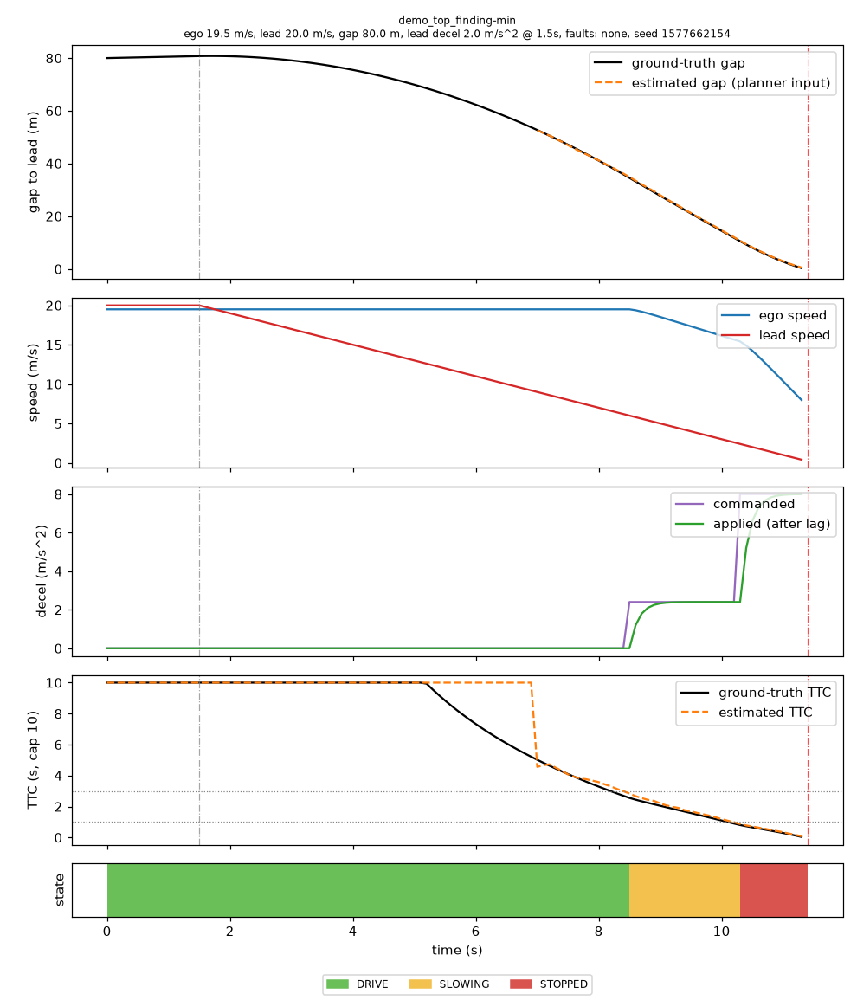
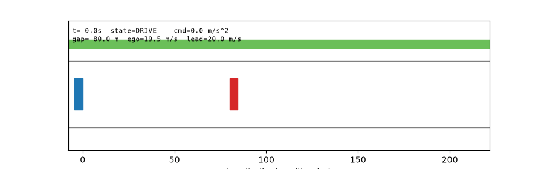
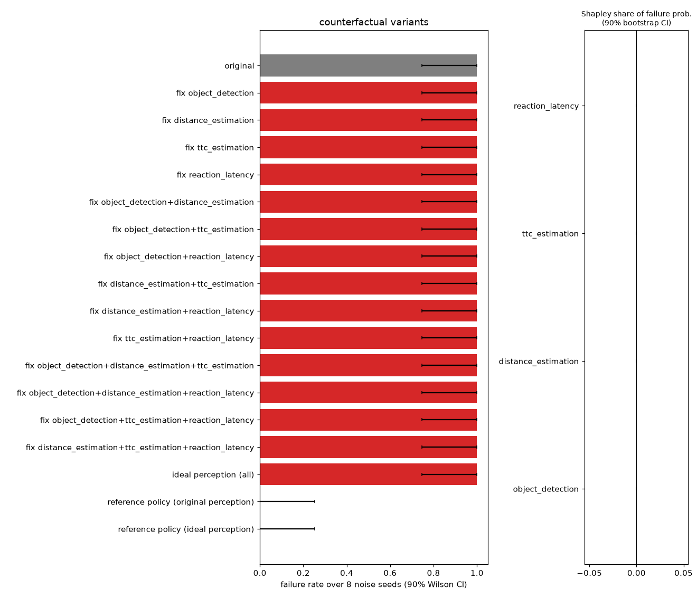

# Autonomy Red Team failure report: Collision (demo_top_finding)

_All numbers below come from executed simulations. Attribution is evidence, not proof._

## 1. Failure summary

- **Failure kind:** `collision` (all kinds exhibited: collision)
- **System under test:** {"name": "safety_sim", "planner_mode": "kalman", "config_overrides": {}, "dt": 0.1, "max_decel": 8.0, "actuator_lag": 0.2}
- **Outcome (minimized scenario):** min gap 0.00 m, impact speed 6.98 m/s, min ground-truth TTC 0.04 s, states visited DRIVE, SLOWING, STOPPED
- **Collision class:** `avoidable` (physically unavoidable = even full braking from t=0 collides; hard = only avoidable with instant reaction; avoidable = a perfect-information reference rule with the production confirmation delay avoids it)
- **Brake reaction time:** 0.00 s from hazard onset (onset t=8.70 s); missed hazards: 0
- **Perception symptoms:** lead lost for 0 closing steps, max range error 0.35 m (symptoms only; causality is tested in section 6)

## 2. Severity and reproducibility

- **Severity score:** 169.8 (collision: 100 + 10 x impact speed; near miss: 50+; missed hazard: 30+; unnecessary braking: 10+)
- **Reproducibility:** reproducible. Deterministic replay identical: True. Failure rate over 20 fresh noise seeds: minimized 100%, original 100%.
- **Noise-seed robustness inside the diagnosis:** original conditions fail in 8/8 seeds.

## 3. Original scenario conditions

`ego 19.9 m/s, lead 8.0 m/s, gap 30.6 m, lead decel 5.4 m/s^2 @ 1.6s, faults: perception_latency, distance_noise, detection_loss, seed 1577662154`

| parameter | value | unit | minimized |
|---|---|---|---|
| `ego_speed` | 19.909 | m/s | 19.5 **(changed)** |
| `lead_speed` | 7.955 | m/s | 20 **(changed)** |
| `initial_gap` | 30.581 | m | 80 **(changed)** |
| `lead_decel` | 5.414 | m/s^2 | 2 **(changed)** |
| `brake_onset_s` | 1.601 | s | 1.5 **(changed)** |
| `perception_latency_s` | 0.304 | s | 0 **(changed)** |
| `distance_noise_std_m` | 0.456 | m | 0 **(changed)** |
| `dropout_prob` | 0 |  | 0 |
| `detection_loss_start_s` | 1.375 | s | 0 **(changed)** |
| `detection_loss_duration_s` | 1.387 | s | 0 **(changed)** |
| `ttc_error_factor` | 1 | x | 1 |
| `ghost_prob` | 0 |  | 0 |
| `seed` | 1577662154 | | 1577662154 |

## 4. Minimized failure conditions

- Faults needed to reproduce: **none (fails with no injected faults)**; removed as unnecessary: perception_latency, distance_noise, detection_loss.
- Replays used: 30. Distance to the "boring" scenario (weighted L1, see `minimize.py`): 4.12 -> 1.19.
- The minimized values are *a* boundary point found by bisection along each axis, not a unique minimum.

| phase | parameter | from | to | note |
|---|---|---|---|---|
| fault_removal | `perception_latency_s` | 0.304 | 0.0 | perception_latency not needed |
| fault_removal | `distance_noise_std_m` | 0.456 | 0.0 | distance_noise not needed |
| fault_removal | `detection_loss_start_s` | 1.375 | 0.0 | detection_loss not needed |
| fault_removal | `detection_loss_duration_s` | 1.387 | 0.0 | detection_loss not needed |
| physical | `lead_decel` | 5.414 | 2.0303 | moved towards benign bound 0.0 |
| physical | `ego_speed` | 19.909 | 19.6917 | moved towards benign bound 6.0 |
| physical | `initial_gap` | 30.581 | 80.0 | moved towards benign bound 80.0 |
| physical | `lead_speed` | 7.955 | 20.0 | moved towards benign bound 20.0 |
| rounding | `ego_speed` | 19.6917 | 19.5 | snapped to a round value |
| rounding | `lead_decel` | 2.0303 | 2.0 | snapped to a round value |
| rounding | `brake_onset_s` | 1.601 | 1.5 | snapped to a round value |

Minimized scenario: `ego 19.5 m/s, lead 20.0 m/s, gap 80.0 m, lead decel 2.0 m/s^2 @ 1.5s, faults: none, seed 1577662154`

## 5. Timeline of key events (minimized scenario)

| t (s) | event | detail |
|---|---|---|
| 1.5 | lead_brake_onset | 2.0 m/s^2 |
| 8.5 | first_brake_command | 2.4 m/s^2 |
| 8.5 | state_change | DRIVE -> SLOWING |
| 8.7 | hazard_onset | ground truth needs >= 3 m/s^2 to stay safe (gap 31.8 m, closing 13.6 m/s, planner state SLOWING) |
| 10.3 | state_change | SLOWING -> STOPPED |
| 11.4 | collision | relative impact speed 6.98 m/s |





## 6. Evidence from controlled interventions

Each variant replays the minimized scenario under identical initial conditions and the same 8 noise seeds (40 simulations). "Fixed" components get ideal behaviour (see `interventions.py`).

| variant | failure rate | 90% CI | mean min gap (m) | collision rate |
|---|---|---|---|---|
| original | 1.00 (8/8) | 0.75-1.00 | 0.00 | 1.00 |
| fix object_detection | 1.00 (8/8) | 0.75-1.00 | 0.00 | 1.00 |
| fix distance_estimation | 1.00 (8/8) | 0.75-1.00 | 0.00 | 1.00 |
| fix ttc_estimation | 1.00 (8/8) | 0.75-1.00 | 0.00 | 1.00 |
| fix reaction_latency | 1.00 (8/8) | 0.75-1.00 | 0.00 | 1.00 |
| fix object_detection+distance_estimation | 1.00 (8/8) | 0.75-1.00 | 0.00 | 1.00 |
| fix object_detection+ttc_estimation | 1.00 (8/8) | 0.75-1.00 | 0.00 | 1.00 |
| fix object_detection+reaction_latency | 1.00 (8/8) | 0.75-1.00 | 0.00 | 1.00 |
| fix distance_estimation+ttc_estimation | 1.00 (8/8) | 0.75-1.00 | 0.00 | 1.00 |
| fix distance_estimation+reaction_latency | 1.00 (8/8) | 0.75-1.00 | 0.00 | 1.00 |
| fix ttc_estimation+reaction_latency | 1.00 (8/8) | 0.75-1.00 | 0.00 | 1.00 |
| fix object_detection+distance_estimation+ttc_estimation | 1.00 (8/8) | 0.75-1.00 | 0.00 | 1.00 |
| fix object_detection+distance_estimation+reaction_latency | 1.00 (8/8) | 0.75-1.00 | 0.00 | 1.00 |
| fix object_detection+ttc_estimation+reaction_latency | 1.00 (8/8) | 0.75-1.00 | 0.00 | 1.00 |
| fix distance_estimation+ttc_estimation+reaction_latency | 1.00 (8/8) | 0.75-1.00 | 0.00 | 1.00 |
| ideal perception (all) | 1.00 (8/8) | 0.75-1.00 | 0.00 | 1.00 |
| reference policy (original perception) | 0.00 (0/8) | 0.00-0.25 | 2.12 | 0.00 |
| reference policy (ideal perception) | 0.00 (0/8) | 0.00-0.25 | 2.14 | 0.00 |



Single interventions on the scenario's own seed (changed metrics):

| intervention | failure rate original -> with | paired seeds fixed / broken | changed metrics (seed 0) |
|---|---|---|---|
| `ideal_detection` | 1.00 -> 1.00 | 0 / 0 | none |
| `oracle_distance` | 1.00 -> 1.00 | 0 / 0 | none |
| `oracle_ttc` | 1.00 -> 1.00 | 0 / 0 | impact_speed: 6.98 -> 6.46; min_ttc: 0.04 -> 0.065; first_brake_t: 8.5 -> 8.3 |
| `no_latency` | 1.00 -> 1.00 | 0 / 0 | none |
| `policy=reference` | 1.00 -> 0.00 | 8 / 0 | collision: True -> False; impact_speed: 6.98 -> 0.0; min_gap: 0.0 -> 2.123; min_ttc: 0.04 -> 1.178; max_state: STOPPED -> SLOWING; first_brake_t: 8.5 -> 7.0 |
| `ideal_detection,oracle_distance,oracle_ttc,no_latency` | 1.00 -> 0.00 | 8 / 0 | collision: True -> False; impact_speed: 6.98 -> 0.0; min_gap: 0.0 -> 2.136; min_ttc: 0.04 -> 1.142; brake_reaction_time: 0.0 -> 0.1; max_state: STOPPED -> SLOWING; first_brake_t: 8.5 -> 7.0 |

## 7. Suspected contributing components

Status rule: *supported* if the lower 90 % bound of the Shapley share exceeds 0.10; *weak* if only the point estimate does; planner logic is *supported* if the failure persists with ideal perception (lower bound > 0.5) and the reference rule fails at least 0.25 less often.

- **Planner decision logic / thresholds: supported**
  - with ideal perception the production planner still fails in 8/8 seeds (rate 1.00, 90% CI 0.75..1.00)
  - the reference RSS rule on ideal perception fails in 0/8 seeds
  - kinematic oracle: collision class = avoidable (max-brake from t=0 collides: False; reference policy with perfect information collides: False)
- **Object detection: not supported**
  - Shapley share of failure probability +0.00 (90% CI +0.00..+0.00)
  - fixing only this component changes the failure rate by -0.00 (1.00 -> 1.00)
  - with every other component ideal, this component alone yields a failure rate of 1.00 (ideal-perception baseline 1.00)
- **Distance estimation: not supported**
  - Shapley share of failure probability +0.00 (90% CI +0.00..+0.00)
  - fixing only this component changes the failure rate by -0.00 (1.00 -> 1.00)
  - with every other component ideal, this component alone yields a failure rate of 1.00 (ideal-perception baseline 1.00)
- **TTC estimation: not supported**
  - Shapley share of failure probability +0.00 (90% CI +0.00..+0.00)
  - fixing only this component changes the failure rate by -0.00 (1.00 -> 1.00)
  - with every other component ideal, this component alone yields a failure rate of 1.00 (ideal-perception baseline 1.00)
- **Reaction latency (perception): not supported**
  - Shapley share of failure probability +0.00 (90% CI +0.00..+0.00)
  - fixing only this component changes the failure rate by -0.00 (1.00 -> 1.00)
  - with every other component ideal, this component alone yields a failure rate of 1.00 (ideal-perception baseline 1.00)

> failure persists with ideal perception: perception cannot be the whole explanation
> Labels are evidence consistent with a cause (Shapley share and 90 % intervals over noise seeds), not a proof of a unique root cause; components interact and the attribution is conditional on this scenario, planner configuration and noise model.

## 8. Recommended engineering changes

Candidate changes derived from the evidence above; none has been validated.

- Planner logic: failure persists with ideal perception. Peak ground-truth required deceleration was 58.2 m/s^2 while the SLOWING state commands only 2.4 m/s^2; STOPPED was first commanded at t=10.3s with a ground-truth gap of 10.5 m at 15.4 m/s (braking distance at full decel: 14.9 m + 3.1 m travelled during the 0.2 s actuator lag). Candidate change: size the stop zone with the actuator lag and escalation hysteresis (extra term closing * (lag + hysteresis time)), and scale SLOWING brake with required deceleration. Not validated: re-run `regress` and `search` after any change.

## 9. Reproduce and guard against regression

```bash
python -m autonomy_redteam demo --seed 42 --budget 100
python -m autonomy_redteam minimize --scenario output/redteam/demo/investigation/original_scenario.json
python -m autonomy_redteam regress --suite output/redteam/demo/regression_suite --baseline output/redteam/demo/baseline_v1.json
```
