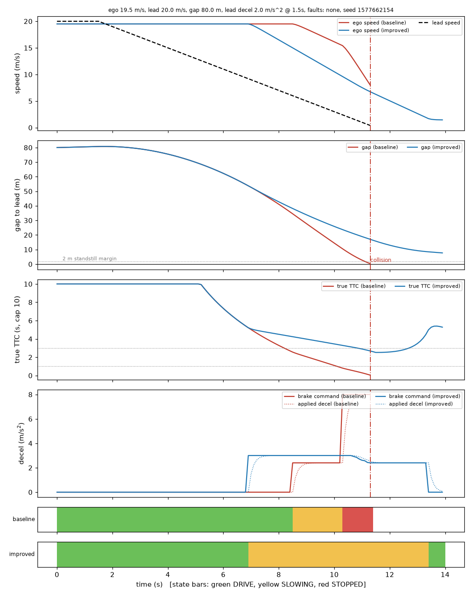

# Failure-to-fix: gentle lead braking at highway speed

Generated by `python -m autonomy_redteam fix-demo --seed 42 --budget 100`; every number below was computed by that run.

## 1. Discovery

Random search (seed 42, 100 simulations) against the original planner: 28 failing scenarios, first at simulation #1. Most severe finding: `ego 19.9 m/s, lead 8.0 m/s, gap 30.6 m, lead decel 5.4 m/s^2 @ 1.6s, faults: perception_latency, distance_noise, detection_loss, seed 1577662154`.

## 2. Minimisation

Reduced to `ego 19.5 m/s, lead 20.0 m/s, gap 80.0 m, lead decel 2.0 m/s^2 @ 1.5s, faults: none, seed 1577662154` (faults needed: none). Reproducibility: reproducible.

## 3. Diagnosis

- attribution: primary root cause: Planner decision logic / thresholds
  - Planner decision logic / thresholds: primary root cause; with every perception component ideal the planner still fails in 8/8 seeds (90% CI 0.75..1.00); the RSS reference on the same inputs fails in 0.00 of seeds (a comparison point, not ground truth)

Mechanism (from telemetry): the planner left DRIVE at t=8.5 s but only commanded the SLOWING level (about 2.7 m/s^2 on average) while the ground truth needed 5.3 m/s^2 on average (peak 9.9). STOPPED was reached at t=10.3 s with 10.5 m left and 13.0 m/s closing; stopping needs 14.5 m even at the full 8 m/s^2 once the actuator lag is included, and the planner also wants to keep 2 m. The stop threshold assumes instantaneous braking.

## 4. Improvement

Deterministic improved braking policy (`src/safe_braking.py`): required deceleration from closing speed and separation, corrected for actuator lag and filter delay, proportional braking with a 1.25 margin, TTC cannot trigger a stop on its own, unconfirmed tracks cannot trigger hard braking, hysteresis on release. No LLM in the loop.

| scenario | planner | collisions | mean min gap (m) | mean impact speed (m/s) |
|---|---|---|---|---|
| minimized | baseline | 16/16 | 0.0 | 6.58 |
| minimized | improved | 0/16 | 7.65 | 0.0 |
| original fault laden | baseline | 16/16 | 0.0 | 13.99 |
| original fault laden | improved | 16/16 | 0.0 | 12.27 |

The originally discovered scenario also carries perception faults (latency, range noise, detection loss). The planner change does not fix it, and the diagnosis says why, before and after:

- baseline planner: verdict **primary** (planner_logic)
- improved planner: verdict **joint** (object_detection, reaction_latency)

With the fix, the planner-logic cause disappears and what remains is perception (late or missing lead information); this is a separate defect class that a braking policy cannot repair.

## 5. Validation on unseen scenarios

300 fresh random scenarios (seed 31337), identical for both planners, paired exact McNemar. These scenarios were not used to build or tune the policy. The full pre-registered held-out evaluation (several sets, CIs, controls) is in `docs/redteam/planner_eval/`.

| outcome | baseline | improved | only baseline / only improved | McNemar p |
|---|---|---|---|---|
| avoidable collision | 0.260 | 0.083 | 56 / 3 | 1.19e-13 |
| any collision | 0.260 | 0.083 | 56 / 3 | 1.19e-13 |
| unnecessary braking | 0.067 | 0.033 | 18 / 8 | 0.0755 |
| margin violation (<1 m) | 0.307 | 0.097 | 66 / 3 | 1.86e-16 |
| any failure | 0.347 | 0.123 | 76 / 9 | 2.41e-14 |

## 6. Regression protection

The minimised failure is now a scenario in the regression suite; recorded on the improved planner it has the role `safe_contract`, i.e. a contract: it must stay collision-free in every noise seed.

- improved planner vs its own baseline: **PASS**
- original planner vs the improved baseline: **FAIL** (hard_violation; violations: fail_01_collision_lead_braking, fail_02_collision_lead_braking, fail_03_collision_lead_braking, fail_04_collision_lead_braking, known_failure_gentle_lead_braking, pass_01_lead_braking, pass_02_steady, pass_03_parked)

Reintroducing the original behaviour is therefore caught by the regression gate.

## Limits

- One simulator, one longitudinal scenario family; the actuator is a first-order lag model.
- The improved policy was developed against this failure and mechanism; the unseen-scenario table is the evidence it is not specific to it. Remaining failures after the fix are mostly perception-fault induced and are listed in `docs/redteam/planner_eval/`.
